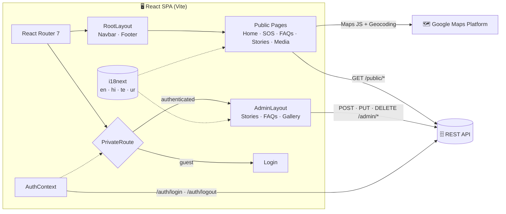
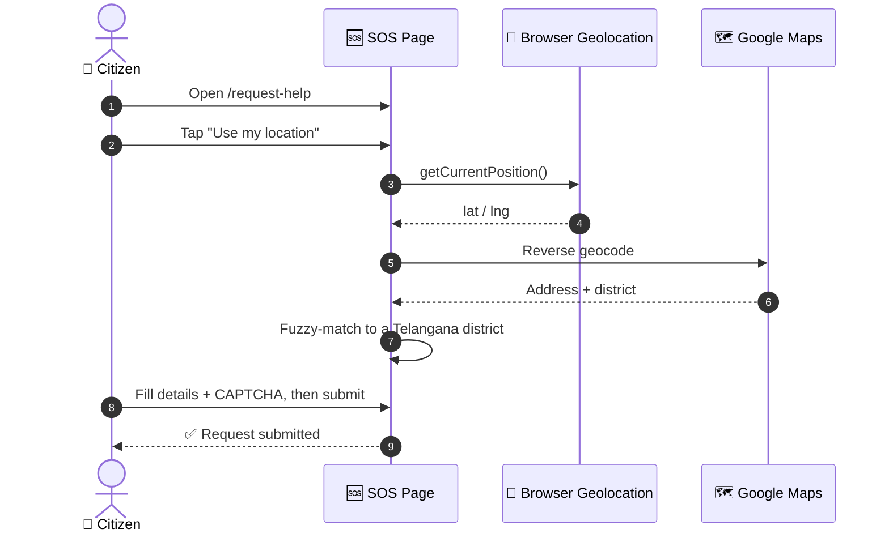

<!-- ===================== BANNER ===================== -->
<p align="center">
  
</p>

<p align="center">
  <a href="https://github.com/Samorash17/ERSS">
    
  </a>
</p>

<p align="center">
  
  
  
  
  
  
  
</p>

<p align="center">
  
  
  
  
  
</p>

<p align="center">
  <a href="#-overview">Overview</a> •
  <a href="#-key-features">Features</a> •
  <a href="#-tech-stack">Tech Stack</a> •
  <a href="#%EF%B8%8F-architecture">Architecture</a> •
  <a href="#-getting-started">Getting Started</a> •
  <a href="#-project-structure">Structure</a> •
  <a href="#-roadmap">Roadmap</a> •
  <a href="#-contributors">Team</a>
</p>

---

## 📖 Overview

**ERSS (Emergency Response Support System)** is the citizen-facing web portal for **Dial 112 Telangana**, a single emergency number that connects people to **Police, Fire, Ambulance, Women Safety, Child Protection and Disaster Response** services.

The portal helps citizens:

- 🆘 **Request help online.** An SOS form pinpoints the caller on a live Google Map and fills in the district automatically.
- 📚 **Learn how Dial 112 works**, from call reception through location detection to dispatch.
- 🌐 **Use the site in their own language** (English, Hindi, Telugu or Urdu).
- ♿ **Read comfortably** with built-in font-size accessibility controls.
- 🏆 **See the impact** through success stories, a media gallery and FAQs, all managed through a secure **admin dashboard**.

> [!IMPORTANT]
> **In a real emergency, always dial `112` from your phone.** The web portal supports the helpline. It does not replace it.

---

## ✨ Key Features

<table>
  <tr>
    <td width="50%" valign="top">

### 🆘 Smart SOS Request
- Interactive **Google Map** with a draggable marker
- **One-tap geolocation** through the browser Geolocation API
- **Reverse geocoding** that matches the location to **Telangana districts**, with fuzzy matching for spelling variants
- Emergency type, personal details and CAPTCHA validation

</td>
    <td width="50%" valign="top">

### 🌐 Multilingual by Design
- **4 languages:** English · हिंदी · తెలుగు · اردو
- Built on `i18next` with automatic browser-language detection
- Language switcher in the navbar that remembers the user's choice
- Admin content (FAQs, stories, gallery) is written **per language**

</td>
  </tr>
  <tr>
    <td width="50%" valign="top">

### 🛡️ Admin CMS Dashboard
- Protected `/admin` routes using `PrivateRoute` and `AuthContext`
- Full **CRUD** for **Success Stories**, **FAQs** and **Media Gallery**
- Cookie-based session auth against a REST API
- Multilingual input fields for every content item

</td>
    <td width="50%" valign="top">

### 🎨 Modern, Accessible UI
- Smooth animations with **Framer Motion**, triggered as sections scroll into view
- **Fully responsive** from mobile to desktop
- **A− / A / A+** font-size controls
- Success-story carousel, image gallery lightbox and an emergency marquee banner

</td>
  </tr>
</table>

### 🗺️ Pages at a Glance

| Route | Page | Description |
|---|---|---|
| `/` | 🏠 Home | Hero, leadership, mission & vision, helpline services |
| `/request-help` | 🆘 SOS | Location-aware emergency request form |
| `/features` | ⚡ Features | Unified response, location fusion, AI voice bot, drones and more |
| `/how-it-works` | 🔄 How It Works | Step-by-step journey of a 112 call |
| `/success-stories` | 🏆 Success Stories | Real rescues, loaded dynamically from the API |
| `/media` · `/image-gallery` | 🖼️ Media | Photo gallery with lightbox |
| `/faqs` | ❓ FAQs | Frequently asked questions (CMS-driven) |
| `/feedback` | 💬 Feedback | Multi-step citizen feedback form |
| `/about` | ℹ️ About Us | About the Emergency Response Support System |
| `/citizen-login` | 👤 Login | Citizen login |
| `/admin/*` | 🔐 Admin | Dashboard, stories, FAQs and gallery management |
| `/Privacy-Policy` · `/Terms-and-Conditions` · `/Copyright` | 📄 Legal | Policy pages |

---

## 🧰 Tech Stack

<p align="center">
  <a href="https://skillicons.dev">
    
  </a>
</p>

| Layer | Technology |
|---|---|
| **Framework** | React 19 (functional components and hooks) |
| **Build Tool** | Vite 7 with HMR |
| **Routing** | React Router 7 (`createBrowserRouter`, nested layouts, protected routes) |
| **Animation** | Framer Motion 12 |
| **Internationalization** | i18next, react-i18next, i18next-browser-languagedetector |
| **Maps & Location** | `@react-google-maps/api`, Geolocation API, Geocoding |
| **State & Auth** | React Context API (`AuthContext`) |
| **Styling** | Modular CSS per component and a shared theme (`theme.css`) |
| **Code Quality** | ESLint 9 (React Hooks and React Refresh plugins) |
| **Testing Libraries** | Testing Library (React, Jest-DOM, User-Event), jsdom, fast-check |
| **Deployment** | Vercel (SPA rewrites in `vercel.json`) |

---

## 🏗️ Architecture



### 🔄 SOS Request Flow



---

## 🚀 Getting Started

### Prerequisites

- **Node.js** ≥ 18 (LTS recommended)
- **npm** ≥ 9
- A **Google Maps API key** with the *Maps JavaScript API* and *Geocoding API* enabled
- *(Optional)* The ERSS backend API running on `http://localhost:5000` for dynamic content and admin features

### Installation

```bash
# 1. Clone the repository
git clone https://github.com/Samorash17/ERSS.git
cd ERSS

# 2. Install dependencies
npm install

# 3. Configure environment variables
cp .env.example .env
#    then add your Google Maps key to .env

# 4. Start the dev server
npm run dev
```

The app runs at **http://localhost:5173** 🎉

### 🔐 Environment Variables

| Variable | Required | Description |
|---|:---:|---|
| `VITE_GOOGLE_MAPS_API_KEY` | ✅ | Google Maps JavaScript and Geocoding API key used by the SOS page |

> [!TIP]
> The backend base URL is set in [`src/utils/api.js`](src/utils/api.js) (default `http://localhost:5000/api`). Point it at your deployed API before a production build.

### 📜 Available Scripts

| Command | Description |
|---|---|
| `npm run dev` | Start the Vite dev server with hot module replacement |
| `npm run build` | Create an optimized production build in `dist/` |
| `npm run preview` | Serve the production build locally |
| `npm run lint` | Run ESLint across the project |

---

## 🔌 API Reference

The frontend talks to a REST backend through a small fetch wrapper ([`src/utils/api.js`](src/utils/api.js)) that sends cookie credentials with every request.

<details>
<summary><b>📡 View endpoints</b></summary>

<br/>

| Method | Endpoint | Access | Purpose |
|---|---|:---:|---|
| `POST` | `/auth/login` | Public | Admin login (sets session cookie) |
| `POST` | `/auth/logout` | Admin | Log out |
| `GET` | `/public/faqs` | Public | List FAQs |
| `GET` | `/public/stories` | Public | List success stories |
| `GET` | `/public/gallery` | Public | List gallery images |
| `POST` · `PUT` · `DELETE` | `/admin/faqs[/:id]` | Admin | Manage FAQs |
| `POST` · `PUT` · `DELETE` | `/admin/stories[/:id]` | Admin | Manage success stories |
| `POST` · `PUT` · `DELETE` | `/admin/gallery[/:id]` | Admin | Manage gallery items |

</details>

---

## 📁 Project Structure

<details open>
<summary><b>📂 Click to collapse</b></summary>

```text
ERSS/
├── 📄 index.html                # App entry HTML
├── ⚙️ vite.config.js            # Vite configuration
├── ⚙️ vercel.json               # SPA rewrites for Vercel
├── 🔑 .env.example              # Environment variable template
├── 📂 HTML Standalone Pages/    # Static HTML versions of key components
├── 📂 public/
└── 📂 src/
    ├── 🚪 main.jsx              # React root and providers
    ├── 🧭 App.jsx               # Router and route definitions
    ├── 📂 assets/               # Images, icons, gallery and stories media
    ├── 📂 components/           # Navbar, Hero, Footer, Marquee, AccessibilityControls, PrivateRoute…
    ├── 📂 context/              # AuthContext (admin session)
    ├── 📂 i18n/                 # i18next configuration
    ├── 📂 locales/              # en · hi · te · ur translation files
    ├── 📂 layouts/              # AdminLayout
    ├── 📂 pages/                # Public pages
    │   └── 📂 admin/            # Dashboard, ManageStories, ManageFAQs, ManageGallery
    ├── 📂 styles/               # Per-component CSS and theme.css
    └── 📂 utils/                # API client and i18n helpers
```

</details>

---

## 📸 Screenshots

<!--
  Add screenshots to docs/screenshots/ and uncomment the table below.

<table>
  <tr>
    <td align="center"><br/><b>Home</b></td>
    <td align="center"><br/><b>SOS Request</b></td>
  </tr>
  <tr>
    <td align="center"><br/><b>Success Stories</b></td>
    <td align="center"><br/><b>Admin Dashboard</b></td>
  </tr>
</table>
-->

| 🏠 Home | 🆘 SOS Request | 🏆 Success Stories | 🛡️ Admin |
|:---:|:---:|:---:|:---:|
| Hero, leadership and services | Map-based location picker | Animated carousel | Multilingual CMS |

---

## 🌍 Internationalization

Translations live in `src/locales/<lang>/translation.json` and load through i18next.

| Code | Language | Native |
|:---:|---|---|
| `en` | English | English |
| `hi` | Hindi | हिंदी |
| `te` | Telugu | తెలుగు |
| `ur` | Urdu | اردو |

To **add a language**:
1. Create `src/locales/<code>/translation.json` (copy the `en` file as a template).
2. Register it in [`src/i18n/config.js`](src/i18n/config.js).
3. Add it to the `languages` list in [`AccessibilityControls.jsx`](src/components/AccessibilityControls.jsx).

---

## ☁️ Deployment

The project is set up for **Vercel**. `vercel.json` rewrites every route to `index.html` so client-side routing keeps working on refresh.

```bash
npm run build      # outputs to dist/
```

1. Import the repository on [vercel.com](https://vercel.com).
2. Framework preset: **Vite**. Build command: `npm run build`. Output directory: `dist`.
3. Add `VITE_GOOGLE_MAPS_API_KEY` under **Project → Settings → Environment Variables**.

[](https://vercel.com/new/clone?repository-url=https://github.com/Samorash17/ERSS)

---

## 🗺️ Roadmap

- [x] Responsive multi-page portal with animated UI
- [x] Multilingual support (EN · HI · TE · UR)
- [x] SOS page with geolocation and district auto-detection
- [x] Admin CMS for stories, FAQs and gallery
- [x] Accessibility font-size controls
- [ ] Move the API base URL to an environment variable
- [ ] Right-to-left (RTL) layout for Urdu
- [ ] Real-time request status tracking
- [ ] PWA support for offline access
- [ ] Unit and integration test suite in CI

---

## 🤝 Contributing

Contributions are welcome!

1. **Fork** the repository
2. Create a feature branch: `git checkout -b feature/amazing-feature`
3. Commit your changes: `git commit -m "feat: add amazing feature"`
4. Push the branch: `git push origin feature/amazing-feature`
5. Open a **Pull Request** 🚀

Please run `npm run lint` before opening a PR.

---

## 👥 Contributors

<p align="center">
  <a href="https://github.com/Samorash17/ERSS/graphs/contributors">
    
  </a>
</p>

---

## 📄 License

This project was built for the **Dial 112 Emergency Response Support System, Telangana**. Logos, photographs and official imagery belong to their respective government owners and are used for this project only. See the in-app [Copyright](src/pages/Copyright.jsx) page for details.

---

<p align="center">
  <b>⭐ If you found this project useful, consider giving it a star!</b>
</p>

<p align="center">
  Made with ❤️ for public safety in Telangana
</p>


